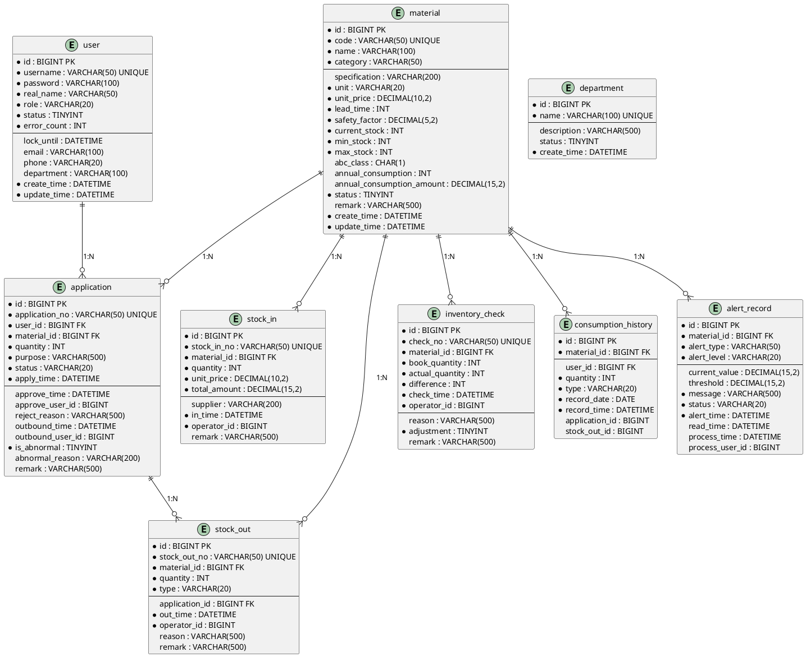

# 数据库ER图设计说明

本文档描述企业办公室物资管理系统（OfficeSupplyMS）的数据库ER图设计，基于实际数据库结构。

---

## 一、数据库概览

系统共包含 **10张业务数据表**（不含 Quartz 定时任务相关表），以及 **2个视图**：

### 业务数据表

| 序号 | 表名 | 说明 |
|------|------|------|
| 1 | user | 用户表 |
| 2 | department | 部门表 |
| 3 | material | 物资档案表 |
| 4 | application | 申领单表 |
| 5 | stock_in | 入库单表 |
| 6 | stock_out | 出库单表 |
| 7 | inventory_check | 库存盘点表 |
| 8 | consumption_history | 历史消耗记录表 |
| 9 | alert_record | 预警记录表 |
| 10 | report_snapshot | 数据报表快照表 |

### 视图

| 序号 | 视图名 | 说明 |
|------|--------|------|
| 1 | material_inventory_view | 物资库存视图 |
| 2 | application_detail_view | 申领单详情视图 |

---

## 二、ER图绘制规范

### 2.1 图形规范

| 元素 | 形状 | 说明 |
|------|------|------|
| 实体（表） | 三线表 | 上方表名，下方字段列表 |
| 主键 | 加粗/PK标注 | 字段后加 (PK) |
| 外键 | FK标注 | 字段后加 (FK) |
| 非空字段 | NOT NULL | 字段后加 * |
| 关系连线 | 实线 + 箭头 | 箭头指向被关联方 |

### 2.2 关系类型

| 符号 | 含义 |
|------|------|
| 1 ───< n | 一对多（1:N） |
| 1 ────── 1 | 一对一（1:1） |

---

## 三、实体详细设计

### 3.1 用户表 (user)

```
┌─────────────────────────────────────────────────────────┐
│                         user                               │
├─────────────────────────────────────────────────────────┤
│ * id               BIGINT        主键，自增               │
│ * username         VARCHAR(50)   用户名，唯一              │
│ * password         VARCHAR(100)  密码（MD5/BCrypt加密）   │
│ * real_name        VARCHAR(50)   真实姓名                 │
│ * role             VARCHAR(20)   角色：admin/user        │
│ * status           TINYINT      状态：1正常/0禁用        │
│ * error_count     INT           密码错误次数              │
│   lock_until      DATETIME      锁定截止时间              │
│   email            VARCHAR(100)  邮箱                     │
│   phone            VARCHAR(20)   手机号                   │
│   department       VARCHAR(100)  部门                     │
│ * create_time      DATETIME     创建时间                  │
│ * update_time      DATETIME     更新时间                  │
└─────────────────────────────────────────────────────────┘
```

**主键**: id
**唯一索引**: username
**业务说明**: 密码错误计数和锁定功能用于安全防护

---

### 3.2 部门表 (department)

```
┌─────────────────────────────────────────────────────────┐
│                       department                           │
├─────────────────────────────────────────────────────────┤
│ * id               BIGINT        主键，自增               │
│ * name             VARCHAR(100)  部门名称，唯一          │
│   description      VARCHAR(500)  部门描述                 │
│   status           TINYINT      状态：1正常/0禁用       │
│ * create_time      DATETIME     创建时间                  │
└─────────────────────────────────────────────────────────┘
```

**主键**: id
**唯一索引**: name

---

### 3.3 物资档案表 (material)

```
┌─────────────────────────────────────────────────────────┐
│                        material                           │
├─────────────────────────────────────────────────────────┤
│ * id               BIGINT        主键，自增               │
│ * code             VARCHAR(50)   物资编码，唯一            │
│ * name             VARCHAR(100)  物资名称                 │
│ * category         VARCHAR(50)   物资类别                 │
│   specification    VARCHAR(200) 规格                    │
│ * unit             VARCHAR(20)   单位                    │
│ * unit_price       DECIMAL(10,2) 单价（精确到分）        │
│ * lead_time        INT          采购提前期（天）         │
│ * safety_factor    DECIMAL(5,2) 安全系数（默认1.5）     │
│ * current_stock    INT          当前库存                 │
│ * min_stock        INT          最低库存/安全库存         │
│ * max_stock        INT          最高库存                 │
│   abc_class        CHAR(1)      ABC分类：A/B/C          │
│   annual_consumption      INT   年消耗量                 │
│   annual_consumption_amount  DECIMAL(15,2) 年消耗金额   │
│ * status           TINYINT      状态：1正常/0停用       │
│   remark           VARCHAR(500) 备注                    │
│ * create_time      DATETIME     创建时间                  │
│ * update_time      DATETIME     更新时间                  │
└─────────────────────────────────────────────────────────┘
```

**主键**: id
**唯一索引**: code

---

### 3.4 申领单表 (application)

```
┌─────────────────────────────────────────────────────────┐
│                      application                           │
├─────────────────────────────────────────────────────────┤
│ * id               BIGINT        主键，自增               │
│ * application_no   VARCHAR(50)   申领单号，唯一           │
│ * user_id          BIGINT (FK)  申请人ID               │
│ * material_id      BIGINT (FK)  物资ID                 │
│ * quantity         INT          申领数量                 │
│ * purpose          VARCHAR(500)  用途                   │
│ * status           VARCHAR(20)  状态：PENDING/APPROVED/ │
│                                  REJECTED/TO_BE_OUTBOUND/│
│                                  COMPLETED              │
│ * apply_time       DATETIME     申请时间                 │
│   approve_time     DATETIME     审批时间                 │
│   approve_user_id  BIGINT      审批人ID                │
│   reject_reason    VARCHAR(500) 驳回原因                 │
│   outbound_time    DATETIME     出库时间                 │
│   outbound_user_id BIGINT      出库操作人ID             │
│ * is_abnormal      TINYINT      是否异常：0正常/1异常    │
│   abnormal_reason  VARCHAR(200) 异常原因                 │
│   remark           VARCHAR(500) 备注                    │
└─────────────────────────────────────────────────────────┘
```

**主键**: id
**唯一索引**: application_no
**外键索引**: user_id → user.id, material_id → material.id
**业务索引**: idx_user_id, idx_material_id, idx_status, idx_apply_time

---

### 3.5 入库单表 (stock_in)

```
┌─────────────────────────────────────────────────────────┐
│                       stock_in                            │
├─────────────────────────────────────────────────────────┤
│ * id               BIGINT        主键，自增               │
│ * stock_in_no      VARCHAR(50)   入库单号，唯一           │
│ * material_id      BIGINT (FK)  物资ID                 │
│ * quantity         INT          入库数量                 │
│ * unit_price       DECIMAL(10,2) 入库单价               │
│ * total_amount     DECIMAL(15,2) 入库总金额            │
│   supplier         VARCHAR(200) 供应商                  │
│ * in_time          DATETIME     入库时间                 │
│ * operator_id      BIGINT       操作人ID                │
│   remark           VARCHAR(500) 备注                    │
└─────────────────────────────────────────────────────────┘
```

**主键**: id
**唯一索引**: stock_in_no
**外键索引**: material_id → material.id
**业务索引**: idx_material_id, idx_in_time

---

### 3.6 出库单表 (stock_out)

```
┌─────────────────────────────────────────────────────────┐
│                      stock_out                             │
├─────────────────────────────────────────────────────────┤
│ * id               BIGINT        主键，自增               │
│ * stock_out_no     VARCHAR(50)   出库单号，唯一           │
│ * material_id      BIGINT (FK)  物资ID                 │
│ * quantity         INT          出库数量                 │
│ * type             VARCHAR(20)   出库类型：APPLICATION/  │
│                                  DIRECT/SCRAP           │
│   application_id   BIGINT (FK)  关联申领单ID           │
│ * out_time         DATETIME     出库时间                 │
│ * operator_id      BIGINT       操作人ID                │
│   reason           VARCHAR(500) 出库原因                 │
│   remark           VARCHAR(500) 备注                    │
└─────────────────────────────────────────────────────────┘
```

**主键**: id
**唯一索引**: stock_out_no
**外键索引**: material_id → material.id, application_id → application.id
**业务索引**: idx_material_id, idx_out_time, idx_application_id

---

### 3.7 库存盘点表 (inventory_check)

```
┌─────────────────────────────────────────────────────────┐
│                    inventory_check                        │
├─────────────────────────────────────────────────────────┤
│ * id               BIGINT        主键，自增               │
│ * check_no         VARCHAR(50)   盘点单号，唯一           │
│ * material_id      BIGINT (FK)  物资ID                 │
│ * book_quantity    INT          账面数量                 │
│ * actual_quantity  INT          实际数量                 │
│ * difference       INT          差异数量（实际-账面）     │
│ * check_time       DATETIME     盘点时间                 │
│ * operator_id      BIGINT       操作人ID                │
│   reason           VARCHAR(500) 差异原因                 │
│ * adjustment       TINYINT      是否已调整：0未/1已       │
│   remark           VARCHAR(500) 备注                    │
└─────────────────────────────────────────────────────────┘
```

**主键**: id
**唯一索引**: check_no
**外键索引**: material_id → material.id
**业务索引**: idx_material_id, idx_check_time

---

### 3.8 历史消耗记录表 (consumption_history)

```
┌─────────────────────────────────────────────────────────┐
│                 consumption_history                        │
├─────────────────────────────────────────────────────────┤
│ * id               BIGINT        主键，自增               │
│ * material_id      BIGINT (FK)  物资ID                 │
│   user_id          BIGINT (FK)  用户ID（申领时记录）   │
│ * quantity         INT          消耗数量                 │
│ * type             VARCHAR(20)  类型：APPLICATION/OUTBOUND│
│ * record_date      DATE         记录日期                 │
│ * record_time      DATETIME     记录时间                 │
│   application_id   BIGINT       关联申领单ID            │
│   stock_out_id     BIGINT       关联出库单ID            │
└─────────────────────────────────────────────────────────┘
```

**主键**: id
**外键索引**: material_id → material.id, user_id → user.id
**业务索引**: idx_material_id, idx_user_id, idx_record_date

---

### 3.9 预警记录表 (alert_record)

```
┌─────────────────────────────────────────────────────────┐
│                      alert_record                         │
├─────────────────────────────────────────────────────────┤
│ * id               BIGINT        主键，自增               │
│ * material_id      BIGINT (FK)  物资ID                 │
│ * alert_type       VARCHAR(50)  预警类型：LOW_STOCK/   │
│                                    ABNORMAL_APPLICATION │
│ * alert_level      VARCHAR(20)  预警等级：HIGH/MEDIUM/│
│                                    LOW                  │
│   current_value    DECIMAL(15,2) 当前值               │
│   threshold        DECIMAL(15,2) 阈值                 │
│ * message          VARCHAR(500) 预警信息               │
│ * status           VARCHAR(20)  状态：UNREAD/READ/    │
│                                    PROCESSED             │
│ * alert_time       DATETIME     预警时间                 │
│   read_time        DATETIME     读取时间                 │
│   process_time     DATETIME     处理时间                 │
│   process_user_id  BIGINT       处理人ID                │
└─────────────────────────────────────────────────────────┘
```

**主键**: id
**外键索引**: material_id → material.id
**业务索引**: idx_material_id, idx_alert_type, idx_status, idx_alert_time

---

### 3.10 数据报表快照表 (report_snapshot)

```
┌─────────────────────────────────────────────────────────┐
│                    report_snapshot                        │
├─────────────────────────────────────────────────────────┤
│ * id               BIGINT        主键，自增               │
│ * report_type      VARCHAR(50)   报表类型                │
│ * report_date      DATE          报表日期                │
│ * data             JSON          报表数据                │
│ * create_time      DATETIME      创建时间                │
└─────────────────────────────────────────────────────────┘
```

**主键**: id
**唯一索引**: report_type + report_date

---

## 四、ER图关系总览

```
┌──────────────┐         ┌──────────────────┐         ┌──────────────┐
│     user     │1──<────│   application    │n──>1───┤   material   │
└──────────────┘         └──────────────────┘         └──────────────┘
       │                         │                         │
       │ n                      │1                         │ n
       │                        │                          │
       ▼                        ▼                         ▼
┌──────────────────┐  ┌──────────────────┐    ┌──────────────────┐
│consumption_history│  │   stock_out      │    │    stock_in      │
└──────────────────┘  └──────────────────┘    └──────────────────┘
                              │                         │
                              │ n                       │ n
                              ▼                         ▼
                    ┌──────────────────┐    ┌──────────────────┐
                    │  inventory_check │    │   alert_record   │
                    └──────────────────┘    └──────────────────┘
```

**注意**: user 和 department 表之间没有外键约束，department 字段存储在 user 表中（非外键关联）。

---

## 五、实体关系说明

| 序号 | 关系 | 实体1 | 实体2 | 类型 | 说明 |
|------|------|-------|-------|------|------|
| 1 | 用户-申领单 | user | application | 1:N | 一个用户可提交多个申领单 |
| 2 | 物资-申领单 | material | application | 1:N | 一种物资可被多次申领 |
| 3 | 物资-入库单 | material | stock_in | 1:N | 一种物资可多次入库 |
| 4 | 物资-出库单 | material | stock_out | 1:N | 一种物资可多次出库 |
| 5 | 申领单-出库单 | application | stock_out | 1:N | 一个申领单可对应一次出库 |
| 6 | 物资-盘点单 | material | inventory_check | 1:N | 一种物资可多次盘点 |
| 7 | 物资-消耗历史 | material | consumption_history | 1:N | 一种物资有多条消耗记录 |
| 8 | 物资-预警记录 | material | alert_record | 1:N | 一种物资可产生多条预警 |

---

## 六、数据库设计特点

### 6.1 部门独立管理
- 部门信息存储在独立的 department 表中
- 用户表通过 department 字段关联部门（非外键约束）

### 6.2 库存直接存储
- 库存信息直接存储在 material 表的 current_stock 字段中
- 无需独立的库存表，简化数据模型

### 6.3 安全防护机制
- 用户表包含 error_count 和 lock_until 字段
- 用于密码错误计数和账号锁定功能

### 6.4 历史追溯
- report_snapshot 表存储计算好的报表数据，提高查询性能

---

## 七、绘制工具推荐

| 工具 | 特点 | 适用场景 |
|------|------|----------|
| **draw.io / diagrams.net** | 免费在线工具，支持导出PNG/SVG | 通用ER图绘制 |
| **Navicat ER Diagram** | Navicat内置功能，直连数据库 | 数据库逆向生成ER图 |
| **MySQL Workbench** | MySQL官方工具 | 数据库建模 |
| **PowerDesigner** | 专业数据库设计工具 | 企业级设计 |
| **PlantUML** | 文本描述，在线渲染 | 快速生成，代码管理 |

---

## 八、PlantUML代码


